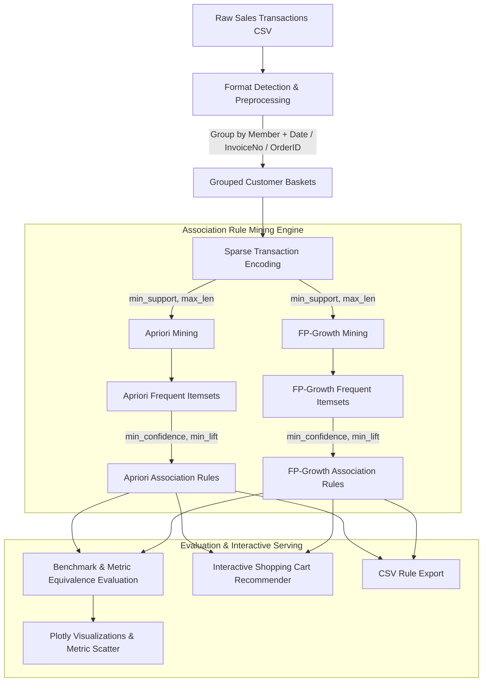

# 🛒 Market Basket Analysis: "Frequently Bought Together" Recommender System

[](https://www.python.org/)
[](https://streamlit.io/)
[](https://rasbt.github.io/mlxtend/)
[](https://plotly.com/)
[](https://pandas.pydata.org/)
[](https://opensource.org/licenses/MIT)
[](https://github.com/)

> An enterprise-grade data mining and recommendation engine that uncovers hidden customer purchase behaviors and powers real-time **"Frequently Bought Together"** recommendations using **Apriori** and **FP-Growth** algorithms.

---

## 📑 Table of Contents

- [Overview](#-overview)
- [Key Features](#-key-features)
- [System Architecture](#-system-architecture)
- [Mathematical Formulation & Core Metrics](#-mathematical-formulation--core-metrics)
  - [Formulas & Definitions](#formulas--definitions)
  - [Step-by-Step Numerical Example](#step-by-step-numerical-example)
- [Algorithmic Comparison: Apriori vs. FP-Growth](#-algorithmic-comparison-apriori-vs-fp-growth)
- [Supported Datasets & Preprocessing](#-supported-datasets--preprocessing)
- [Streamlit Dashboard Tour](#-streamlit-dashboard-tour)
- [Repository Structure](#-repository-structure)
- [Getting Started](#-getting-started)
  - [Prerequisites](#prerequisites)
  - [Installation](#installation)
  - [Running the Application](#running-the-application)
- [Parameter Tuning & Best Practices](#-parameter-tuning--best-practices)
- [Troubleshooting & FAQ](#-troubleshooting--faq)
- [Presentation & Academic Defense Walkthrough](#-presentation--academic-defense-walkthrough)
- [Future Enhancements & Roadmap](#-future-enhancements--roadmap)
- [License](#-license)

---

## 📌 Overview

In modern retail, e-commerce, and grocery store management, cross-selling complementary products accounts for up to **35% of total revenue** (e.g., Amazon's recommendation engine). **Market Basket Analysis (MBA)** is the foundational unsupervised machine learning discipline used to discover actionable product co-occurrence patterns in transaction databases.

This repository provides an interactive web application that:
1. **Transforms raw transaction logs** into high-dimensional customer shopping baskets.
2. **Implements and benchmarks** the two premier association rule mining algorithms: **Apriori** and **FP-Growth**.
3. **Demonstrates mathematical rule equivalence** while contrasting execution efficiency.
4. **Delivers an interactive cart simulator** where users select products and receive ranked complementary recommendations in real-time.

---

## ✨ Key Features

- **⚡ Dual-Algorithm Benchmark Engine**:
  - Run **Apriori** (breadth-first candidate generation) and **FP-Growth** (compressed prefix-tree mining) side-by-side with matched hyperparameter settings.
  - Automatically measures execution runtime (seconds), rule counts, and mathematical rule overlap ($100\%$ expected on identical thresholds).

- **💾 Memory-Optimized Sparse Transaction Encoding**:
  - Employs `mlxtend.preprocessing.TransactionEncoder(sparse=True)` to convert variable-length shopping baskets into compressed sparse matrices, drastically minimizing RAM consumption for high-cardinality catalogs.

- **📊 Comprehensive Visual Analytics Suite**:
  - **Item Frequency Distribution**: Top 10/20 most popular products bar chart.
  - **Interactive Rule Scatter Plot**: Support vs. Confidence colored by Lift with hover inspect.
  - **Metric Distributions**: Histogram analysis for Support, Confidence, Lift, and Leverage.
  - **Runtime & Scalability Charts**: Bar visualizations comparing execution times and speedup factors.

- **🛒 Live E-Commerce Recommendation Simulator**:
  - Select any item (or combination of items) from the catalog to query the rule base.
  - Ranks complementary suggestions by Lift and Confidence with clear, human-readable business explanations.

- **📁 Flexible Multi-Dataset Ingestion**:
  - Built-in lightweight sample dataset (`sample_groceries.csv`) for zero-configuration testing.
  - Automatic format detection for **Kaggle Groceries**, **Instacart (merged or 2-file relational format)**, and **Online Retail I & II**.
  - Intelligent sampling toggle for large-scale datasets on resource-constrained devices.

- **📥 Business Intelligence Data Exports**:
  - One-click export of Apriori association rules, FP-Growth rules, and algorithm comparison benchmark metrics to standard CSV format.

---

## 🏗️ System Architecture

The following diagram illustrates the complete data processing, rule mining, and recommendation lifecycle:



---

## 📐 Mathematical Formulation & Core Metrics

Association rules express co-occurrence patterns in the form:
$$\text{Antecedent } (A) \implies \text{Consequent } (B)$$

Where $A$ and $B$ are disjoint itemsets ($A \cap B = \emptyset$).

### Formulas & Definitions

| Metric | Formula | Range | Business Meaning |
| :--- | :--- | :--- | :--- |
| **Support** | $\text{Support}(A \implies B) = \frac{\text{Count}(A \cup B)}{N}$ | $[0, 1]$ | **Popularity**: Fraction of all transactions containing both $A$ and $B$. Prevents acting on rare flukes. |
| **Confidence** | $\text{Confidence}(A \implies B) = \frac{\text{Support}(A \cup B)}{\text{Support}(A)}$ | $[0, 1]$ | **Reliability**: Given that $A$ is in the cart, what is the conditional probability that $B$ is also purchased? |
| **Lift** | $\text{Lift}(A \implies B) = \frac{\text{Confidence}(A \implies B)}{\text{Support}(B)} = \frac{P(A \cap B)}{P(A) \cdot P(B)}$ | $[0, \infty)$ | **Strength of Association**: Ratio of observed co-occurrence to co-occurrence expected if purchases were independent. |
| **Leverage** | $\text{Leverage}(A \implies B) = \text{Support}(A \cup B) - (\text{Support}(A) \cdot \text{Support}(B))$ | $[-0.25, 0.25]$ | **Surplus Frequency**: Absolute difference between joint co-occurrence and expected independent occurrences. |
| **Conviction** | $\text{Conviction}(A \implies B) = \frac{1 - \text{Support}(B)}{1 - \text{Confidence}(A \implies B)}$ | $[0, \infty)$ | **Implication Strength**: Frequency with which the rule would be incorrect if $A$ occurred without $B$. |

#### Interpreting Lift Values
- **$\text{Lift} > 1$**: **Positive Association** — Purchasing $A$ significantly increases the likelihood of buying $B$ (ideal for cross-selling & bundling).
- **$\text{Lift} = 1$**: **Independence** — Items $A$ and $B$ occur together purely by random chance; no actionable affinity.
- **$\text{Lift} < 1$**: **Negative Association / Substitutes** — Purchasing $A$ decreases the likelihood of purchasing $B$ (e.g., competing brands or substitute products).

---

### Step-by-Step Numerical Example

Consider a small store database containing $N = 5$ customer shopping baskets:

| Transaction ID | Items in Basket |
| :---: | :--- |
| **$T_1$** | Milk, Bread |
| **$T_2$** | Bread, Butter |
| **$T_3$** | Milk, Bread, Butter |
| **$T_4$** | Milk, Diapers, Beer |
| **$T_5$** | Bread, Butter, Diapers |

We wish to evaluate the rule: **$\{\text{Bread, Butter}\} \implies \{\text{Milk}\}$**

1. **Calculate Itemset Frequencies**:
   - $\text{Count}(\{\text{Bread, Butter}\}) = 3$ ($T_2, T_3, T_5$)
   - $\text{Count}(\{\text{Milk}\}) = 3$ ($T_1, T_3, T_4$)
   - $\text{Count}(\{\text{Bread, Butter, Milk}\}) = 1$ ($T_3$)

2. **Compute Support**:
   $$\text{Support}(\{\text{Bread, Butter}\} \implies \{\text{Milk}\}) = \frac{1}{5} = 0.20 \quad (20\%)$$
   $$\text{Support}(\{\text{Bread, Butter}\}) = \frac{3}{5} = 0.60 \quad (60\%)$$
   $$\text{Support}(\{\text{Milk}\}) = \frac{3}{5} = 0.60 \quad (60\%)$$

3. **Compute Confidence**:
   $$\text{Confidence}(\{\text{Bread, Butter}\} \implies \{\text{Milk}\}) = \frac{\text{Support}(\{\text{Bread, Butter, Milk}\})}{\text{Support}(\{\text{Bread, Butter}\})} = \frac{0.20}{0.60} = 0.333 \quad (33.3\%)$$

4. **Compute Lift**:
   $$\text{Lift}(\{\text{Bread, Butter}\} \implies \{\text{Milk}\}) = \frac{\text{Confidence}}{\text{Support}(\{\text{Milk}\})} = \frac{0.333}{0.60} = 0.556$$
   *Interpretation*: Because $\text{Lift} = 0.556 < 1.0$, customers buying Bread and Butter are actually **less likely** to purchase Milk than a random shopper. This rule would be rejected for cross-selling recommendations.

5. **Compute Leverage**:
   $$\text{Leverage} = 0.20 - (0.60 \times 0.60) = 0.20 - 0.36 = -0.16$$

6. **Compute Conviction**:
   $$\text{Conviction} = \frac{1 - 0.60}{1 - 0.333} = \frac{0.40}{0.667} \approx 0.60$$

---

## 🧠 Algorithmic Comparison: Apriori vs. FP-Growth

Both algorithms solve the exact frequent itemset mining problem, yet their internal paradigms differ substantially:

| Dimension | Apriori Algorithm | FP-Growth (Frequent Pattern Growth) |
| :--- | :--- | :--- |
| **Pioneers** | R. Agrawal & R. Srikant (1994) | J. Han, J. Pei, & Y. Yin (2000) |
| **Strategy** | Level-wise candidate itemset generation (BFS) | Compressed Prefix-Tree (FP-Tree) Mining (DFS) |
| **Database Scans** | Multiple passes ($k$ scans for itemsets of size $k$) | **Exactly 2 passes** over the transaction database |
| **Candidate Generation** | Generates $C_k$ candidate itemsets via $(k-1)$-joins | **Zero candidate generation**; mines tree paths directly |
| **Memory Consumption** | High memory overhead storing combinatorial candidates | Compact tree structure stored in memory |
| **Performance on Large Data** | Degrades exponentially with low support / dense datasets | **Significantly faster** on large & dense transaction datasets |
| **Result Equivalence** | ✅ **100% Identical itemsets and association rules** | ✅ **100% Identical itemsets and association rules** |

> 🔑 **Core Principle**: Apriori and FP-Growth are deterministic exact search algorithms, not probabilistic or approximate models. With matching support and length parameters, **both algorithms discover the identical set of frequent itemsets**. The only divergence is **computational efficiency and memory access patterns**.

---

## 📊 Supported Datasets & Preprocessing

The application provides out-of-the-box support for multiple industry-standard transaction structures:

| Dataset | Included Location | Original Schema | Basket Aggregation Strategy |
| :--- | :--- | :--- | :--- |
| **Kaggle Groceries** | `archive/Groceries_dataset.csv` (~38,765 rows) | `Member_number`, `Date`, `itemDescription` | $\text{TransactionID} = \text{Member\_number} + \text{"\_"} + \text{Date}$ |
| **Online Retail II** | `archive/online_retail_II.csv` (~1M rows) | `Invoice`, `Description`, `Quantity` | Filters cancelled invoices ($Invoice$ starting with `C`) & $Quantity \le 0$; $\text{TransactionID} = \text{Invoice}$ |
| **Instacart (Merged)** | User upload | `order_id`, `product_name` | $\text{TransactionID} = \text{order\_id}$; $\text{item} = \text{product\_name}$ |
| **Instacart (Relational)**| User upload (2 files) | Main: `order_id`, `product_id`<br>Products: `product_id`, `product_name` | Automatically joins `product_name` via `product_id`; $\text{TransactionID} = \text{order\_id}$ |
| **Built-in Sample** | `Market-Basket-App/sample_groceries.csv` | `Member_number`, `Date`, `itemDescription` | Ready-to-run demo without external file downloads |

### Data Transformation Pipeline
Raw transaction logs frequently store one item per row. The system performs:
1. **Cleaning**: Strips leading/trailing whitespace, drops null descriptions, and excludes cancelled orders.
2. **Grouping**: Groups rows by customer and order timestamp into discrete itemsets.
3. **Encoding**: Applies `TransactionEncoder(sparse=True)` to convert variable-length lists into a boolean matrix of dimensions $(N_{\text{transactions}} \times M_{\text{unique items}})$.

---

## 🖥️ Streamlit Dashboard Tour

The application is structured into 7 dedicated analytical tabs:

```text
├── 🛒 Introduction           # Concept explanations, business value, metric cards & formulas
├── 📂 Dataset                # Transaction counts, data preview, and top item frequency chart
├── 📊 Apriori                # Apriori execution metrics, itemset distribution & generated rules
├── 🌲 FP-Growth              # FP-Growth execution metrics, itemset distribution & generated rules
├── ⚖️ Comparison             # Head-to-head runtime benchmark, rule overlap %, and lift scatter
├── 🔍 Recommendation Demo    # Live cart builder with instant complementary product recommendations
└── 📥 Downloads              # Download mined rules and benchmark data in CSV format
```

### 1. 🛒 Introduction Tab
Interactive educational cards detailing the business impact of Market Basket Analysis, Apriori pruning, FP-Tree construction, and mathematical metrics.

### 2. 📂 Dataset Tab
Inspect transaction counts, unique product catalog cardinality, raw tabular records, and interactive Plotly bar charts of the top 20 most frequent items.

### 3. 📊 Apriori & 🌲 FP-Growth Tabs
Review algorithm-specific metrics:
- Total runtime in seconds.
- Total frequent itemsets discovered.
- Itemset support distribution histogram.
- Formatted rules table with Antecedents, Consequents, Support, Confidence, Lift, Leverage, and Conviction.
- Top recommendations highlighted in conversational business language.

### 4. ⚖️ Comparison Tab
- **Speedup Benchmark**: Quantitative execution comparison ($X\text{x}$ speedup factor).
- **Rule Overlap Calculation**: Verifies mathematical consistency across both algorithms.
- **Plotly Scatter Visualization**: Support vs. Confidence colored by Lift, enabling visual identification of high-value rules.

### 5. 🔍 Recommendation Demo Tab
An interactive cart simulator:
- Select one or more items currently in a hypothetical shopping basket (e.g., `whole milk`, `yogurt`, `coffee`).
- The recommendation engine identifies applicable rules where the selected items match the antecedent, sorting suggestions by **Lift** and **Confidence**.
- Displays an intuitive explanation of *why* the product was recommended.

### 6. 📥 Downloads Tab
Export mined association rules and comparison summaries to clean, formatted CSV files for downstream reporting or BI dashboards.

---

## 📂 Repository Structure

```text
Market-Basket-Analysis/
│
├── Market-Basket-App/                # Web application package
│   ├── app.py                        # Streamlit dashboard & recommendation engine
│   ├── sample_groceries.csv          # Built-in lightweight sample dataset
│   └── requirements.txt              # Production dependency specifications
│
├── archive/                          # Benchmark datasets
│   ├── Groceries_dataset.csv         # Kaggle Groceries dataset (~38,765 records)
│   └── online_retail_II.csv          # Online Retail II dataset (e-commerce transactions)
│
├── MarketBasketAnalysis.pptx         # Academic & stakeholder presentation slide deck
├── AGENTS.md                         # Workspace automation guidelines
└── README.md                         # Primary project documentation
```

---

## 🚀 Getting Started

### Prerequisites

- **Python 3.10** or **3.11** (strongly recommended; `mlxtend` has known syntax and dependency deprecations on Python 3.12+).
- Git installed on your system.

### Installation

1. **Clone the Repository**:
   ```bash
   git clone https://github.com/<your-username>/Market-Basket-Analysis.git
   cd Market-Basket-Analysis
   ```

2. **Create and Activate a Virtual Environment**:
   - **On Windows (PowerShell)**:
     ```powershell
     python -m venv .venv
     .venv\Scripts\Activate.ps1
     ```
   - **On macOS / Linux**:
     ```bash
     python3 -m venv .venv
     source .venv/bin/activate
     ```

3. **Install Dependencies**:
   ```bash
   cd Market-Basket-App
   pip install -r requirements.txt
   ```

### Running the Application

Launch the Streamlit web dashboard:

```bash
streamlit run app.py
```

The application will automatically open in your default browser at `http://localhost:8501`.

---

## ⚙️ Parameter Tuning & Best Practices

| Parameter | Recommended (Small Sample) | Recommended (Large / Real Datasets) | Impact & Behavior |
| :--- | :---: | :---: | :--- |
| **Minimum Support** | `0.005` to `0.02` | `0.001` to `0.003` | Sets threshold for frequent itemsets. Lower values capture rarer product combinations but increase computational runtime. |
| **Minimum Confidence** | `0.20` to `0.40` | `0.05` to `0.15` | Filters rules by directional reliability. Large retail datasets have high dispersion, requiring lower confidence thresholds. |
| **Minimum Lift** | `1.0` | `1.0` to `1.2` | Retains rules with positive affinity. A threshold of $\ge 1.0$ guarantees that recommendations outperform random chance. |
| **Maximum Itemset Length** | `3` | `2` or `3` | Restricts rule size ($A \cup B$). Setting $\le 3$ prevents exponential explosion of high-order candidate itemsets. |
| **Sample Size** | Full dataset | `5,000` to `20,000` transactions | Accelerates prototyping on memory-constrained machines. |

> 💡 **Quick Preset**: When uploading full Kaggle or Retail files, click the **"Use large-dataset friendly settings"** button in the sidebar to automatically calibrate support (`0.001`), confidence (`0.05`), and lift (`1.0`).

---

## 🛠️ Troubleshooting & FAQ

### 1. No association rules appear after running the analysis
- **Cause**: Minimum support or confidence thresholds are set too high for sparse retail data.
- **Fix**: In the sidebar, lower **Minimum Support** to `0.001` and **Minimum Confidence** to `0.05`. Ensure **Minimum Lift** is set to `1.0`.

### 2. Streamlit reports a `MemoryError`
- **Cause**: Generating candidate itemsets for hundreds of thousands of transactions without sparse matrices or sampling exceeds available RAM.
- **Fix**: Enable the **Sampling** checkbox in the sidebar and start with 5,000–10,000 transactions. Ensure `max_len` is restricted to 2 or 3.

### 3. `mlxtend` throws an import or runtime error
- **Cause**: Running Python 3.12 or newer.
- **Fix**: Ensure your virtual environment runs Python 3.10 or 3.11 (`python --version`).

### 4. Why is FP-Growth not faster than Apriori on small samples?
- **Explanation**: On very small datasets (under 1,000 transactions) or low itemset lengths (`max_len = 2`), the constant overhead of building the recursive FP-Tree can equal or slightly exceed Apriori's lightweight candidate generation. The dramatic speed advantage of FP-Growth becomes apparent as transaction count and itemset density scale up.

---

## 🎓 Presentation & Academic Defense Walkthrough

If demonstrating this project for a university capstone defense, technical interview, or client demonstration, follow this 5-step narrative:

1. **The Business Problem (1 min)**:
   - Walk through the introductory slide deck (`MarketBasketAnalysis.pptx`).
   - Explain how uncovering item co-occurrences drives merchandising, bundle discounts, and cart cross-selling.

2. **Data Pipeline & Sparse Matrix Transformation (2 mins)**:
   - Open the **Dataset** tab.
   - Explain how raw tabular logs (one item per row) are grouped by `TransactionID = Member + Date` to construct distinct shopping baskets.
   - Explain how `TransactionEncoder(sparse=True)` prevents memory overflow.

3. **Algorithm Execution & Threshold Calibration (2 mins)**:
   - Run both algorithms with identical parameters (`min_support = 0.001`, `min_confidence = 0.05`).
   - Highlight the **Apriori Principle** (if an itemset is infrequent, all of its supersets are infrequent) vs. **FP-Tree compressed mining**.

4. **Benchmarking & Rule Equivalence Proof (2 mins)**:
   - Navigate to the **Comparison** tab.
   - Point to the **Rule Overlap metric (100%)**: prove to your audience that both algorithms produce mathematically identical rule sets.
   - Highlight the runtime comparison chart demonstrating FP-Growth's computational speedup.

5. **Live Cart Recommender Demonstration (2 mins)**:
   - Switch to the **Recommendation Demo** tab.
   - Select items like `whole milk` or `tropical fruit` in the cart.
   - Show how the system recommends complementary items, explaining the business significance of high **Lift** versus baseline support.

---

## 🔮 Future Enhancements & Roadmap

- [ ] **Hierarchical & Category-Aware Mining**: Roll up individual SKUs to category levels (e.g., `Dairy` $\implies$ `Bakery`) to discover macro shopping trends.
- [ ] **Temporal & Seasonal Analysis**: Add time-decay weighting or seasonal filtering to detect holiday and day-of-week basket shifts.
- [ ] **FastAPI Microservice Integration**: Expose a REST API endpoint (`/recommend`) for headless integration with e-commerce checkout systems.
- [ ] **Hybrid Recommender Engine**: Blend collaborative filtering (user-item embeddings) with MBA association rules.

---

## 📄 License

This project is licensed under the **MIT License** — see the [LICENSE](LICENSE) file for details.

---

## 👤 Author & Acknowledgments

- **Developed by**: Tasneem Ibrahim - Rana Sakr
- **Core Libraries**: [Streamlit](https://streamlit.io/), [mlxtend](https://rasbt.github.io/mlxtend/), [Pandas](https://pandas.pydata.org/), [Plotly](https://plotly.com/)
- **Datasets**: Kaggle Groceries Dataset, UCI Online Retail II, Instacart Market Basket Analysis
